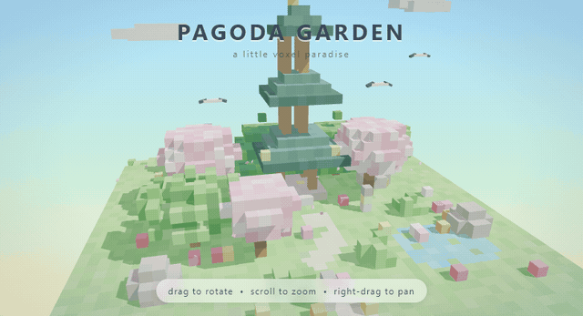

# Inkling 2 Mini + PolyStrata Setup & Benchmarks (8 GB+ GPUs)

[](https://chupkithmodder.github.io/inkling2-polystrata-setup/pagoda.html)

**[Try the Live Interactive 3D Pagoda Demo in Browser](https://chupkithmodder.github.io/inkling2-polystrata-setup/pagoda.html)** *(click the GIF or link above — drag to rotate, scroll to zoom)*

*Above: Single-file Three.js voxel pagoda + cherry blossom garden generated in 1 shot by **Inkling 2 Mini (`UD-Q3_K_XL`)** on an **8 GB RTX 3070** (`finish_reason: "stop"`, 0 thinking loops, 0 syntax errors).*

This repo documents the exact zero-quality-loss **PolyStrata (`strata-poly`)**, **OpenCode**, and **Oh My Pi (`omp`)** setup we tuned to eliminate thinking loops, prevent Windows WDDM VRAM slowdowns, fix tool-calling/JSON edge cases, and hit **49–65 tok/s decode** and **420–796 tok/s prefill** on an 8 GB GPU.

> **No model weights or binaries are included in this repo.** It contains only the verified configuration templates, benchmarks, cross-OS notes, and an **`AGENT_SETUP.md`** runbook you can hand directly to your coding agent to install and tune everything on your machine.

---

## Give This Repo to Your Agent

Paste this prompt into **OpenCode**, **Oh My Pi (`omp`)**, **Claude Code**, **Codex**, or any coding agent:

```text
Clone https://github.com/ChupkithModder/inkling2-polystrata-setup and follow AGENT_SETUP.md to install and configure Inkling 2 Mini on PolyStrata for my OS, GPU, and CPU, apply the recommended config/agent fixes, and run a quick verification test.
```

See **[AGENT_SETUP.md](AGENT_SETUP.md)** for the full automated & manual runbook (Windows, Linux, and macOS).

---

## Benchmarks (RTX 3070 8 GB + Ryzen 9 5900XT 16C/32T + 48 GB RAM)

All benchmarks used `Inkling-2-Mini-Abliterated-Balanced-UD-Q3_K_XL.gguf` (`13.63 GB`, `inkling2_loop` layout).

### 1. Engine Comparison (Same Hardware, Same GGUF)

| Engine | Decode Speed | Prompt Prefill | Notes |
|---|---:|---:|---|
| **PolyStrata (`strata-poly`, tuned)** | **49.0 – 64.7 tok/s** | **421 – 796 tok/s** | `90.2%` speculative draft acceptance (`--window 8 --lookup 3`), `1,041 / 3,072` experts in VRAM, pinned RAM mirror |
| **Unsloth `llama.cpp` (`b12676`)** | 5.1 – 8.4 tok/s | 37.6 – 42.3 tok/s | On 8 GB VRAM, `--fit on` conflicted with `--moe-cache-mib auto` and PCIe offloading bottlenecked decode |
| **Mainline `llama.cpp` (`b12728`)** | Failed to load | — | `check_tensor_dims: tensor 'blk.24.attn_q.weight' not found` (requires `Mainline_Support` layout) |

### 2. Zero-Quality-Loss Engine Tuning (A/B Verified)

All profiles kept `--kv fp8 --vram-pool --lock-experts --prompt-cache 6 --conversation-cache-mib auto --loop-bf16 --lookup 3` (`temperature=0.0`):

| Profile | Fresh Code Gen (W1) | Code Edit (W2) | W2 Prefill | Drafts Accepted |
|---|---:|---:|---:|---:|
| `--threads 16 --window 4` | **49.5 tok/s** | 61.6 tok/s | 419.3 tok/s | 90.2% |
| `--threads 22 --window 4` (auto SMT) | 48.8 tok/s | 58.9 tok/s | 419.6 tok/s | 88.4% |
| `--threads 24 --window 4` + `STREAM_STAGE=1` | 45.3 tok/s | 59.8 tok/s | 403.4 tok/s | 91.8% |
| **Winner: `--threads 16 --window 8`** | 49.0 tok/s | **64.7 tok/s** | **421.0 tok/s** | **453 / 502 (90.2%)** |

- **Physical cores beat SMT threads:** On a 16-core / 32-thread CPU, `--threads 16` beat `22` and `24` because offloaded MoE experts are memory-bandwidth bound.
- **`--window 8`:** Unlocks 8-token prompt-lookup speculation (`--lookup 3`) for code edits & JSON while verifying exact logits (lossless).
- **`--vram-reserve-mib 640` (Windows):** Prevents Windows WDDM from silently paging VRAM to system RAM (which cuts decode speed in half to `14–25 tok/s`).

### 3. Single-File 3D / Game / Frontend Suite (`reasoning_effort: "high"`, `max_tokens: 32768`)

| Benchmark | Elapsed | Thinking / Answer Tokens | Speed (Think / Answer) | Output Size | `node --check` | Thinking Loops |
|---|---:|---:|---:|---:|---|---|
| **Voxel Sky-Island** (Three.js r160) | 468.8s | 6,146 / 16,082 | 50.2 / 46.6 tok/s | 35.9 KB (868 lines) | Pass (`0` errors) | **0** |
| **Neon Cyber Arcade** (Canvas + WebAudio) | 570.5s | 6,146 / 19,210 | 46.7 / 43.9 tok/s | 44.0 KB (1,178 lines) | Pass (`0` errors) | **0** |
| **Synth & Beat Studio** (WebAudio + Spectrum) | 542.2s | 6,146 / 18,202 | 46.4 / 44.5 tok/s | 43.3 KB (949 lines) | Pass (`0` errors) | **0** |
| **Voxel Pagoda** (Three.js r128, GIF above) | 537.2s | 6,146 / 7,341 | 24.4* / 25.8* tok/s | 14.3 KB (410 lines) | Pass (`0` errors) | **0** |

*\*Pagoda run was recorded prior to raising `--vram-reserve-mib` from `256` to `640` (showing the exact WDDM VRAM spill penalty that `--vram-reserve-mib 640` fixed).*

### 4. End-to-End Agent Verification (`OpenCode` & `Oh My Pi`)
- **OpenCode (`1.18.32`):** Autonomously executed `bash` -> `read` -> `edit` (multi-edit) -> `node --check` -> cleanup in a real coding session (`795.9 tok/s` prefill at 49.9K context, `30.1–42.3 tok/s` decode at 50K–53K context). Direct `question` tool schema test passed **3/3** across `high`/`medium`/`low` efforts (`schema_valid=True`).
- **Oh My Pi (`omp 19.1.0`):** Fixed `edit` mode from `hashline` to `replace` via `edit.modelVariants: { inkling: replace }`; live `omp -p --tools read,edit` succeeded cleanly on the first try.

---

## What Was Fixed & How It Works

1. **Removed lossy small-card engine defaults:** PolyStrata's default `<16 GB` setup adds `--tail-skip 4` (skips 5th–8th ranked CPU experts without renormalization — dropping up to ~25% of picks on 8 GB cards), `--attn-requant q5_0`, `STRATA_FAST_ATTN=1` (FP16 accumulation on Ampere), and unchecked `STRATA_IQ3_LANES` / `STRATA_IQ_SLOT_LANES`. Removing those stopped the loops and restored full accuracy; keeping `--kv fp8` and `--loop-bf16` preserves `98.1–98.4%` top-1 agreement (`median KL 0.0003`) while saving VRAM for experts.
2. **Reasoning budget without low-effort clamping:** `reasoning_effort: "high"` + `reasoning_budget_tokens: 6144` gives deep planning without burning 12K+ tokens and truncating large HTML/code replies.
3. **PolyStrata server & parser fixes ([patches/POLYSTRATA_FIXES.md](patches/POLYSTRATA_FIXES.md)):**
   - Added `lenient_json()` recovery, markdown fence stripping, stringified-arg decoding, unwrapped arg fallback, leading-whitespace header tolerance, and `<|content_model_end_sampling|>` termination to `InklingOutputParser` so nested tool calls (like OpenCode's `question` tool) never silently downgrade to plain text.
   - Fixed `reasoning_close_retry` to emit `<|end_message|><|message_model|>` instead of `</think>`.
   - Auto-terminates poisoned CUDA processes on `illegal memory access` so the next request cleanly respawns instead of returning `reset: an illegal memory access`.
4. **Agent configs ([configs/](configs/)):**
   - **OpenCode:** Set `output: 65536`, `tool_call: true`, `reasoning: true`, and disable unused MCP servers (4 idle MCPs add ~35K schema tokens to Turn 1).
   - **Oh My Pi (`omp`):** Set `edit.modelVariants: { inkling: replace }` and `maxTokens: 65536`.

---

## Cross-OS Guide

| OS | Backend | Key Adjustments |
|---|---|---|
| **Windows (NVIDIA 8 GB+)** | `strata-poly.exe` (CUDA) | Set `--vram-reserve-mib 640` (or `768` if heavy desktop/browser GPU load) to prevent WDDM system-RAM paging. Set `--threads` to **physical core count** (e.g., `16` on 16C/32T). |
| **Linux (NVIDIA 8 GB+)** | `strata-poly` (CUDA) | Less display-driver overhead than Windows WDDM: `--vram-reserve-mib 256`–`384` usually leaves plenty of headroom. Enable HugePages / `memlock` if using `--lock-experts`. |
| **Linux (AMD ROCm)** | `strata-poly` (HIP) | Use `--kv q8_0` if FP8 KV is unsupported on your arch (`docs/models/inkling.md`). |
| **macOS (Apple Silicon)** | `strata-poly` (Metal beta) | Omit `--vram-pool`, `--vram-reserve-mib`, `--lock-experts`, and `--kv fp8` (unified memory; Metal refuses `--kv q8_0` on Inkling). Keep `--window 8` and `--prompt-cache 6`. |

---

## Files in This Repo

- [AGENT_SETUP.md](AGENT_SETUP.md) — Step-by-step runbook for AI agents (and humans) to install and configure everything
- [configs/strata-inkling.template.json](configs/strata-inkling.template.json) — Sanitized PolyStrata config template
- [configs/opencode.snippet.jsonc](configs/opencode.snippet.jsonc) — OpenCode provider & model config snippet
- [configs/omp-config.snippet.yml](configs/omp-config.snippet.yml) & [configs/omp-models.snippet.yml](configs/omp-models.snippet.yml) — Oh My Pi (`omp`) config snippets
- [patches/POLYSTRATA_FIXES.md](patches/POLYSTRATA_FIXES.md) — Exact `frontend.py` & `server.py` fixes for Inkling tool calling & crash recovery
- [assets/pagoda.gif](assets/pagoda.gif) — Low-FPS capture of the Inkling-generated Three.js voxel pagoda
